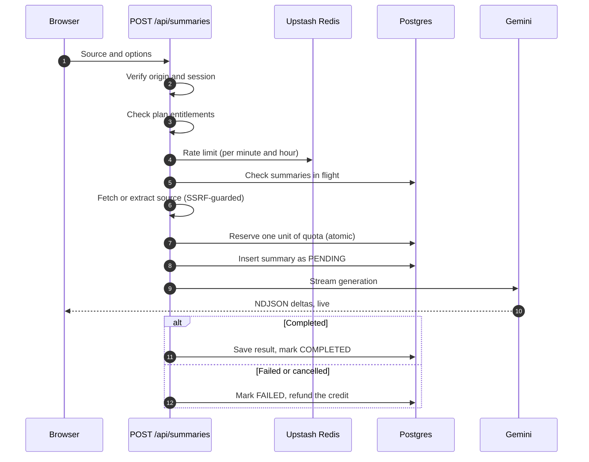
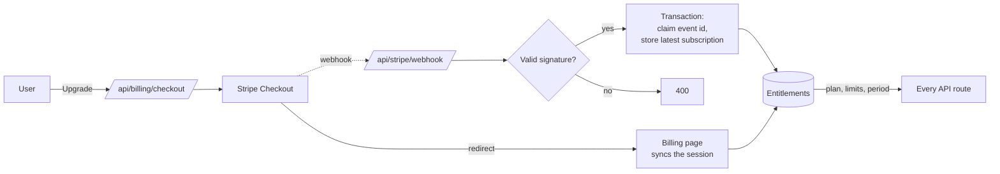

<div align="center">


<br />

**An AI summarization SaaS with a luxury design language.**
Paste text, add a link, or upload a document. Choose the shape, tone, and language. Read a clear summary as it is written.

<br />

[](https://nextjs.org)
[](https://react.dev)
[](https://www.typescriptlang.org)
[](https://tailwindcss.com)
[](https://www.prisma.io)
[](https://neon.tech)
[](https://stripe.com)
[](https://ai.google.dev)

[Live preview](https://lumen-ai-saas.vercel.app) &nbsp;·&nbsp; [Features](#features) &nbsp;·&nbsp; [Getting started](#getting-started) &nbsp;·&nbsp; [Architecture](#architecture) &nbsp;·&nbsp; [Security](#security) &nbsp;·&nbsp; [Deployment](#deployment)

</div>

<br />

> **Status: pre-launch.** The application is feature-complete, hardened, and covered by unit, database, and browser tests. Billing runs in Stripe **test mode**, and several launch steps (domain, billed AI key, legal review) are tracked in [`docs/LAUNCH.md`](docs/LAUNCH.md). The live preview above is a test deployment, not a commercial service.

---

## Table of contents

- [Overview](#overview)
- [Features](#features)
- [Plans and limits](#plans-and-limits)
- [Tech stack](#tech-stack)
- [Architecture](#architecture)
- [Project structure](#project-structure)
- [Getting started](#getting-started)
- [Environment variables](#environment-variables)
- [Scripts](#scripts)
- [Testing](#testing)
- [API reference](#api-reference)
- [Security](#security)
- [Deployment](#deployment)
- [Operations and launch](#operations-and-launch)
- [Design system](#design-system)
- [Roadmap](#roadmap)
- [License](#license)

---

## Overview

Lumen turns long material into something you can act on. A user signs up, adds a source, picks how they want it summarized, and watches the result stream in. Every summary is saved to a searchable archive.

The product has two faces:

- **A cinematic marketing site.** Six dedicated pages, plus legal pages, with a WebGL hero on the home page that degrades gracefully to a static gradient.
- **A quiet, fast application.** An obsidian-and-champagne dashboard built for reading: overview, workspace, archive, billing, and settings.

The visual language is restrained and precise: obsidian backgrounds, ivory text, champagne-gold accents, subtle glass surfaces, film grain, and slow, weighted motion.

## Features

### Summarization

- **Three modes:** _Executive Brief_ (bottom line, key facts, implications), _Key Points_ (ordered bullets), and _Deep Dive_ (structured analysis, paid plans).
- **Adjustable output:** three lengths, four tones, and twenty output languages, independent of the source language.
- **Any source:** pasted text, public web links, and uploaded **PDF, DOCX, TXT, and Markdown** files (paid plans).
- **Live streaming** with cancel. Cancelled and failed runs never consume quota.
- **Native PDF reading** through Gemini, including scanned documents, with no brittle text-extraction step.

### Account and billing

- **Email and password** with required email verification, **Google sign-in**, password reset, and email-confirmed account deletion.
- **Stripe Checkout** and the **Customer Portal** for subscriptions, plan changes, and cancellation.
- **Server-enforced plans:** modes, sources, input size, file size, and monthly quota are all checked on the server, never trusted from the browser.
- **Upgrade prompts** wherever a limit is reached, driven by the server's answer.

### Archive

- **Saved history** with search, mode and favorite filters, sorting, and compact pagination.
- **Reading view** with sanitized Markdown, copy, Markdown download, favorite, rename, and delete.
- **Dashboard overview** with real usage statistics and a seven-day activity chart.

### Engineering

- **Atomic quota metering** that holds under concurrent requests.
- **SSRF-hardened URL fetching** with DNS-level address pinning.
- **Idempotent Stripe webhooks** processed inside a database transaction.
- **Daily maintenance job** that refunds stuck runs and purges expired data.
- **Strict TypeScript, validated environment, security headers, accessibility-tested pages, and CI.**

## Plans and limits

Limits live in one place, [`src/lib/plans.ts`](src/lib/plans.ts), and drive both enforcement and the copy on the pricing and billing pages, so the two cannot drift apart.

|                     | Free                        | Pro                | Team               |
| ------------------- | --------------------------- | ------------------ | ------------------ |
| Summaries per month | 10                          | 300                | 1,500              |
| Max input           | 5,000 words                 | 50,000 words       | 150,000 words      |
| Modes               | Executive Brief, Key Points | All three          | All three          |
| Sources             | Text, web links             | Text, links, files | Text, links, files |
| File uploads        | None                        | Up to 4 MB         | Up to 4 MB         |
| AI model tier       | Lite                        | Standard           | Standard           |
| Price (USD / month) | 0                           | 12                 | 39                 |

Prices are defined in [`src/lib/billing.ts`](src/lib/billing.ts) and created in Stripe by `npm run stripe:setup`. Paid plans are metered on the Stripe billing period; the Free plan on the UTC calendar month.

## Tech stack

| Layer          | Technology                                                                                         |
| -------------- | -------------------------------------------------------------------------------------------------- |
| Framework      | Next.js 16 (App Router, Turbopack), React 19                                                       |
| Language       | TypeScript (strict, `noUncheckedIndexedAccess`)                                                    |
| Styling        | Tailwind CSS v4, shadcn/ui on Base UI, CSS-variable design tokens                                  |
| 3D             | Three.js with React Three Fiber, lazy-loaded on the home page only                                 |
| Database       | PostgreSQL on Neon, Prisma 7 with the Neon driver adapter                                          |
| Authentication | Better Auth (email and password, Google OAuth)                                                     |
| AI             | Google Gemini (`@google/genai`)                                                                    |
| Billing        | Stripe Checkout, Customer Portal, webhooks                                                         |
| Email          | Resend                                                                                             |
| Rate limiting  | Upstash Redis (summaries, billing), database storage (authentication)                              |
| Validation     | Zod 4, `@t3-oss/env-nextjs`                                                                        |
| Content        | `react-markdown` with `rehype-sanitize`; Mozilla Readability, linkedom, and mammoth for extraction |
| Testing        | Vitest, Playwright, axe-core                                                                       |
| Hosting        | Vercel (Frankfurt), Vercel Cron                                                                    |

## Architecture

### Creating a summary

Every step before the model call is cheap and fails fast. Quota is claimed atomically, and any failure after that point gives the credit back.



### Billing

Stripe is the source of truth. A webhook event only signals that something changed; the handler re-fetches the subscription from Stripe and stores its current state, so event order and replays never matter.



### Design principles

- **The server decides.** The browser sends intent; plan limits, ownership, and quota are enforced on the server.
- **Fail closed, refund on failure.** Users pay only for summaries they receive.
- **One source of truth.** Plan limits, prices, option lists, and copy come from shared configuration with tests guarding against drift (for example, a test that fails if TypeScript option lists diverge from the Prisma enums).
- **Pure core, thin shell.** Business rules are pure functions or take injected dependencies, which is why the streaming, fallback, quota, and webhook logic can be tested without the network.

## Project structure

```text
.
├── .github/                    CI workflow and Dependabot
├── docs/                       Runbook, launch checklist, images
├── e2e/                        Playwright browser tests
├── prisma/                     Schema and migrations
├── scripts/                    Setup, verification, and operations scripts
├── src/
│   ├── app/
│   │   ├── (marketing)/        Home, features, how-it-works, showcase, pricing, FAQ, privacy, terms
│   │   ├── (auth)/             Sign in, sign up, forgot and reset password, verify email
│   │   ├── dashboard/          Overview, new summary, archive, billing, settings
│   │   └── api/                summaries, usage, preferences, billing, stripe, auth, cron, health
│   ├── components/             ui/, app/, auth/, billing/, marketing/, settings/, three/, workspace/
│   ├── lib/                    Pure shared logic: plans, billing, validation, formatting, parsing
│   ├── server/
│   │   ├── ai/                 Prompt builder, streaming with model fallback, Gemini client
│   │   ├── api/                Route helpers: errors, origin check, sessions, NDJSON streaming
│   │   ├── billing/            Stripe client, checkout, webhook, sync, account cleanup
│   │   ├── extract/            HTML article and document extraction
│   │   ├── net/                SSRF guard and safe fetcher
│   │   └── summarize/          Orchestration service, request parsing, source preparation
│   ├── generated/              Prisma client (git-ignored)
│   ├── env.ts                  Validated environment
│   └── proxy.ts                Optimistic route protection
├── next.config.ts              Security headers and CSP
├── prisma.config.ts            Prisma CLI configuration
├── vercel.json                 Region and cron schedule
└── playwright.config.ts · vitest.config.ts · vitest.db.config.ts
```

## Getting started

### Prerequisites

- **Node.js 22** and npm
- Accounts for the services below. Everything has a free tier suitable for development.

| Service                                                  | Used for                                 |
| -------------------------------------------------------- | ---------------------------------------- |
| [Neon](https://neon.tech)                                | PostgreSQL database                      |
| [Google AI Studio](https://aistudio.google.com)          | Gemini API key                           |
| [Google Cloud Console](https://console.cloud.google.com) | OAuth client for Google sign-in          |
| [Resend](https://resend.com)                             | Verification, reset, and deletion emails |
| [Upstash](https://upstash.com)                           | Redis for rate limiting                  |
| [Stripe](https://stripe.com)                             | Billing (stay in test mode)              |
| [Stripe CLI](https://docs.stripe.com/stripe-cli)         | Forwarding webhooks to localhost         |

### 1. Clone and install

```bash
git clone https://github.com/Abdulgeni/lumen.git
cd lumen
npm install        # also generates the Prisma client
```

### 2. Configure the environment

```bash
cp .env.example .env.local
```

Fill in `.env.local` using the [variable reference](#environment-variables). Generate secrets with `openssl rand -base64 32`.

Create **two Neon branches**, `production` and `dev`. Use the `dev` branch locally, with its **pooled** connection string as `DATABASE_URL` and its **direct** string as `DATABASE_URL_UNPOOLED`.

For Google sign-in, create an OAuth client of type _Web application_ with:

- Authorized JavaScript origin: `http://localhost:3000`
- Authorized redirect URI: `http://localhost:3000/api/auth/callback/google`

### 3. Set up the database

```bash
npm run db:migrate     # applies migrations to your dev branch
npm run db:generate    # regenerates the Prisma client
npm run db:check       # verifies the connection, tables, and cascade deletes
```

### 4. Set up Stripe (test mode)

```bash
npm run stripe:setup   # creates the Pro and Team products and prices
```

Then in the Stripe dashboard (test mode), activate the **Customer Portal** and allow cancellation, payment-method updates, and plan switching between the two Lumen products.

In a second terminal, forward webhooks and copy the printed `whsec_...` secret into `STRIPE_WEBHOOK_SECRET`:

```bash
stripe listen --forward-to localhost:3000/api/stripe/webhook
```

### 5. Run it

```bash
npm run dev
```

Open [http://localhost:3000](http://localhost:3000). Use Stripe's test card `4242 4242 4242 4242` with any future expiry and any CVC to try an upgrade.

> **Tip:** `npm run seed:demo -- you@example.com` fills your dev archive with sample summaries so you can see pagination, search, and the activity chart. Add `--remove` to clean them up.

## Environment variables

All variables are validated at build time by [`src/env.ts`](src/env.ts). A missing or malformed value fails the build with a clear message instead of failing in production.

| Variable                                              | Required   | Purpose                                                                      |
| ----------------------------------------------------- | ---------- | ---------------------------------------------------------------------------- |
| `NEXT_PUBLIC_APP_URL`                                 | Yes        | Public origin, no trailing slash. Used for auth, redirects, and sitemap.     |
| `NEXT_PUBLIC_SUPPORT_EMAIL`                           | Yes        | Contact address shown on legal pages and `security.txt`.                     |
| `DATABASE_URL`                                        | Yes        | Neon **pooled** connection string, used by the running app.                  |
| `DATABASE_URL_UNPOOLED`                               | Local only | Neon **direct** string, used by Prisma migrations. Never set on Vercel.      |
| `BETTER_AUTH_SECRET`                                  | Yes        | 32+ character session-signing secret. Use a different value per environment. |
| `GOOGLE_CLIENT_ID` / `GOOGLE_CLIENT_SECRET`           | Yes        | Google OAuth client.                                                         |
| `RESEND_API_KEY`                                      | Yes        | Resend API key (starts with `re_`).                                          |
| `EMAIL_FROM`                                          | Yes        | Sender, for example `Lumen <hello@your-domain.com>`.                         |
| `GEMINI_API_KEY`                                      | Yes        | Google Gemini API key.                                                       |
| `GEMINI_MODEL_LITE`                                   | No         | Free-tier model. Default `gemini-3.5-flash-lite`.                            |
| `GEMINI_MODEL_STANDARD`                               | No         | Paid-tier model. Default `gemini-3.8-flash`.                                 |
| `GEMINI_MODEL_FALLBACK`                               | No         | Used if the primary model is unavailable. Default `gemini-3.5-flash`.        |
| `UPSTASH_REDIS_REST_URL` / `UPSTASH_REDIS_REST_TOKEN` | Yes        | Redis REST credentials for rate limiting.                                    |
| `STRIPE_SECRET_KEY`                                   | Yes        | Stripe secret key (`sk_test_...` until launch).                              |
| `STRIPE_WEBHOOK_SECRET`                               | Yes        | Webhook signing secret (`whsec_...`).                                        |
| `CRON_SECRET`                                         | Yes        | 32+ character secret. Vercel sends it to authenticate cron calls.            |

Model identifiers are configuration on purpose: Google retires models on a published schedule, and changing one should not require a code change.

## Scripts

| Command                                  | Description                                               |
| ---------------------------------------- | --------------------------------------------------------- |
| `npm run dev`                            | Start the development server                              |
| `npm run build` / `npm start`            | Production build and server                               |
| `npm run typecheck`                      | Generate route types, then run the TypeScript compiler    |
| `npm run lint`                           | ESLint                                                    |
| `npm run format` / `format:check`        | Prettier, write or verify                                 |
| `npm test`                               | Unit tests (no network or database)                       |
| `npm run test:db`                        | Database integration tests, against your **dev** branch   |
| `npm run e2e`                            | Playwright browser tests against the production build     |
| `npm run e2e:install`                    | One-time Chromium install for Playwright                  |
| `npm run db:migrate`                     | Create and apply a migration (development)                |
| `npm run db:deploy`                      | Apply migrations (production, use the direct URL)         |
| `npm run db:generate`                    | Regenerate the Prisma client                              |
| `npm run db:studio`                      | Open Prisma Studio                                        |
| `npm run db:check`                       | Verify the database connection and constraints            |
| `npm run gemini:check`                   | Live smoke test of the AI pipeline and model IDs          |
| `npm run extract:check -- <url or file>` | Try URL or document extraction, including blocked targets |
| `npm run ratelimit:check`                | Verify the Redis rate limiter                             |
| `npm run stripe:setup`                   | Create Stripe products and prices (test mode by default)  |
| `npm run seed:demo -- <email>`           | Add or remove sample summaries for an account             |
| `npm run launch:check`                   | Report what still blocks a production launch              |

## Testing

Quality is enforced in four layers.

**Unit tests (`npm test`).** Fast, with no network or database. They cover plan entitlements, billing periods, prompt construction, the streaming and model-fallback logic, the SSRF address guard and safe fetcher (including redirects into private ranges), document extraction, validation, and formatting.

**Database tests (`npm run test:db`).** Run against a real Postgres branch and prove the guarantees that matter most:

- 15 parallel requests against a 10-credit limit yield exactly 10 accepted
- a failed or cancelled generation refunds its credit exactly once
- eight simultaneous copies of one Stripe event are processed exactly once
- a webhook that fails mid-processing leaves the event unclaimed, so the retry succeeds
- one user can never read, edit, or delete another user's summary
- search treats `%` and `_` literally
- stuck runs are failed and refunded by the maintenance job

**Browser tests (`npm run e2e`).** Playwright drives the production build: public pages and metadata, security headers, forged-cookie rejection, identical messages for wrong passwords and unknown emails, cross-user access (404 in both the app and the API), the archive, and sign-out. axe-core checks the public pages for serious accessibility violations.

**Continuous integration.** [GitHub Actions](.github/workflows/ci.yml) runs formatting, type checks, lint, unit tests, and a production build on every push and pull request, plus a non-blocking dependency audit. Dependabot proposes updates weekly.

## API reference

All routes are same-origin and cookie-authenticated unless noted. Errors share one shape: `{ "error": { "code", "message", ... } }`.

| Method                 | Route                   | Description                                                                                                         |
| ---------------------- | ----------------------- | ------------------------------------------------------------------------------------------------------------------- |
| `POST`                 | `/api/summaries`        | Create a summary and stream it as newline-delimited JSON. Accepts JSON (text, URL) or `multipart/form-data` (file). |
| `GET`                  | `/api/summaries`        | List summaries. Query: `q`, `mode`, `source`, `favorite`, `sort`, `page`, `pageSize`.                               |
| `GET` `PATCH` `DELETE` | `/api/summaries/:id`    | Read, rename or favorite, and delete one summary.                                                                   |
| `GET`                  | `/api/usage`            | Current plan, limits, usage, and subscription state.                                                                |
| `GET` `PUT`            | `/api/preferences`      | Read and save default mode, length, tone, and language.                                                             |
| `POST`                 | `/api/billing/checkout` | Create a Stripe Checkout session for `pro` or `team`.                                                               |
| `POST`                 | `/api/billing/portal`   | Create a Customer Portal session.                                                                                   |
| `POST`                 | `/api/stripe/webhook`   | Stripe events. Requires a valid signature.                                                                          |
| `GET`                  | `/api/cron/cleanup`     | Maintenance job. Requires the cron bearer secret.                                                                   |
| `GET`                  | `/api/health`           | Liveness check.                                                                                                     |
| `*`                    | `/api/auth/*`           | Authentication, handled by Better Auth.                                                                             |

**Status codes:** `401` not signed in · `403` wrong origin · `400` invalid input · `402` plan or quota limit (includes `upgradeTo`) · `413` too large · `415` unsupported type · `422` unreadable source · `429` rate limited (includes `Retry-After`).

**Stream events** from `POST /api/summaries`, one JSON object per line: `start`, `delta`, `done`, `error`.

## Security

Lumen began as a rebuild of a prototype whose security was fundamentally unsound, so these protections were designed in and are verified by tests rather than assumed.

| Area                    | Protection                                                                                                                                                                                                                           |
| ----------------------- | ------------------------------------------------------------------------------------------------------------------------------------------------------------------------------------------------------------------------------------ |
| **Sessions**            | Better Auth sessions validated against the database on every request. A proxy gives fast redirects, but never grants access on its own.                                                                                              |
| **Authentication**      | Required email verification, hashed passwords, per-endpoint rate limits, identical errors for wrong password and unknown email, redirect targets validated against open redirects.                                                   |
| **Authorization**       | Every query is scoped to the owning user. Another user's resource returns `404`.                                                                                                                                                     |
| **Plans and quota**     | Enforced on the server. Quota is claimed with one atomic conditional update, so concurrent requests cannot overspend.                                                                                                                |
| **Billing**             | Webhook signatures are mandatory. Events are claimed transactionally and state is re-fetched from Stripe, so replays and reordering are harmless. Checkout and portal redirect URLs come from configuration, never from the request. |
| **URL fetching (SSRF)** | Only `http` and `https` on ports 80 and 443, no IP literals or internal hostnames, every connection pinned to a public address at connect time, redirects re-validated hop by hop, and size and time caps.                           |
| **Files**               | Types are identified from content, not names or MIME headers. Size is capped per plan.                                                                                                                                               |
| **AI safety**           | Source text is delimited and declared untrusted in the prompt. Rendered output is sanitized Markdown with images disabled.                                                                                                           |
| **Headers**             | A Content Security Policy that blocks foreign scripts, plugins, framing, and form targets, plus HSTS, `nosniff`, `Referrer-Policy`, `Permissions-Policy`, and COOP.                                                                  |
| **Configuration**       | The build fails on missing or malformed environment variables. No secrets in the client bundle.                                                                                                                                      |
| **Data lifecycle**      | Daily cleanup of stale runs, failed summaries, expired tokens, and old counters. Account deletion cascades through all of a user's data and deletes the Stripe customer.                                                             |

**Known trade-offs.** The CSP permits inline scripts because Next.js requires them for hydration, and moving to nonces would cost static rendering on marketing pages. The rate limiter fails open if Redis is unreachable, because the database quota remains the hard cost ceiling. A decompression-bomb DOCX is bounded by the file-size cap and function memory rather than by a dedicated check.

To report a vulnerability, use the contact address in [`/.well-known/security.txt`](public/.well-known) on the deployed site.

## Deployment

Lumen is built for [Vercel](https://vercel.com).

1. **Create the project** from this repository. Set the function region to match your database (this project uses Frankfurt, `fra1`, configured in `vercel.json`).
2. **Add every environment variable** from the [reference](#environment-variables) for the Production, Preview, and Development environments. Use separate secrets and, ideally, a separate Neon branch for each.
3. **Migrate the production database** with the **direct** connection string before deploying code that needs the change:
   ```bash
   read -rsp "Production DIRECT url: " DATABASE_URL_UNPOOLED && export DATABASE_URL_UNPOOLED
   npm run db:deploy
   unset DATABASE_URL_UNPOOLED
   ```
4. **Register the Stripe webhook** at `https://YOUR-DOMAIN/api/stripe/webhook` for these events: `checkout.session.completed` and `customer.subscription.created`, `.updated`, `.deleted`, `.paused`, `.resumed`. Store its signing secret as `STRIPE_WEBHOOK_SECRET`.
5. **Add production URLs** to the Google OAuth client (origin and `/api/auth/callback/google` redirect).
6. **Cron** is declared in `vercel.json` and runs `/api/cron/cleanup` daily. Vercel authenticates it with `CRON_SECRET`.

Preview deployments are for reviewing the interface. Authentication callbacks are registered for production and local origins only.

## Operations and launch

| Document                             | Contents                                                                                                    |
| ------------------------------------ | ----------------------------------------------------------------------------------------------------------- |
| [`docs/RUNBOOK.md`](docs/RUNBOOK.md) | Services and failure modes, deploying and rolling back, incident playbooks, secret rotation, data handling  |
| [`docs/LAUNCH.md`](docs/LAUNCH.md)   | The pre-launch checklist: billed AI key, custom domain and email, live Stripe, legal review, platform plans |

`npm run launch:check` reports the blockers a script can detect. It is expected to fail until the project is configured for production.

## Design system

The interface is built from a small set of design tokens defined in [`src/app/globals.css`](src/app/globals.css) and mapped onto Tailwind and shadcn/ui.

| Token          | Value     | Use                             |
| -------------- | --------- | ------------------------------- |
| Obsidian       | `#0A0A0B` | Page background                 |
| Surface        | `#111114` | Cards and panels                |
| Ivory          | `#F5F1E8` | Primary text                    |
| Champagne gold | `#C8A96A` | Accents, focus, primary actions |
| Gold light     | `#E6D3A3` | Highlights, shimmer             |
| Gold deep      | `#8F7638` | Gradient depth                  |
| Emerald accent | `#0F3D33` | Atmospheric glow                |

Typography pairs **Cormorant Garamond** for display with **Inter** for text. Surfaces use glass utilities, a fixed film-grain overlay, and a slow, weighted easing curve. All motion respects `prefers-reduced-motion`, the 3D hero is skipped on reduced motion, Data Saver, and devices without WebGL, and a forced-colors fallback keeps gradient text readable.

## Roadmap

Ideas that are not built yet, roughly in priority order:

- Error monitoring with Sentry
- A real support inbox and published status page
- Annual billing
- Regenerating a summary with different settings
- Team seats and shared archives
- Additional export formats

## License

Copyright © 2026 Abdulgeni. All rights reserved.

This repository is proprietary. No license is granted to use, copy, modify, or distribute the code without written permission. To open-source it, replace this section with a license of your choice.
